# Music Manager

**A local music-library manager for composers and producers.** Organize your songs, lyrics, albums and mixtapes, make every track the same loudness, and export clean files that carry your own metadata (title, artist, composer, copyright, lyrics, cover). Windows 10/11 and Mac. English, Spanish, German and Portuguese.

Everything runs on your own computer. There are no accounts and no uploads: your music never leaves your machine.

## Download

[**⬇ Download the latest version**](https://github.com/frankiedl/Music-Manager/releases/latest) (Windows and Mac, free)

1. **Download** the zip for your system from the *Releases* page (Windows, Mac Apple Silicon or Mac Intel).
2. **Unzip** it into a folder of your own, for example `Documents/MusicManager`. Do not run it from inside the zip.
3. **Open** `GestorMusica.exe` (Windows) or `GestorMusica.app` (Mac). Your browser opens with the manager. The first time, choose the folder where your music lives (it can be a new, empty one).

The app is not code-signed yet, so your system warns you the first time:
- **Windows:** "Windows protected your PC" → *More info* → *Run anyway*.
- **Mac:** right-click the app → *Open* → *Open* (only needed once).

The zip includes a PDF manual in four languages. Windows 10 has not been tested yet; Windows 11 has.

## How it works

- **Your music is never moved or deleted.** The manager reads your library folder. Everything it creates (normalized masters, mixtape files) is a *new* file; your originals stay as they are.
- **Your work lives next to the app**, in a `datos/` folder: stars, notes, names, sketches, mixtapes, album order. Nothing is written into your music folders except files you explicitly export or save as masters.
- **It runs on your computer only** (`127.0.0.1`) and works offline.
- **Folders become songs.** A song is a folder with its lyrics (`letra.txt`), audio files, versions, master and stems. The folders `unreleased/`, `prereleased/` and `published/` are your catalog; the manager shows each song with what it has and what is missing.

### The workflow

1. **Import** your music from any folder (DAW exports, bounces, old folders). The importer *copies* files into your library and sorts them; it never touches the source.
2. **Organize**: listen to versions, star and annotate songs, merge duplicates, mark sketches, write or paste lyrics.
3. **Build albums and mixtapes** by dragging songs in and ordering them.
4. **Normalize** the loudness so every track plays at the same level (a target in LUFS, with a peak ceiling).
5. **Export** a ZIP or save the masters, with your own metadata and cover written into every file.

## Features

All screenshots use invented demo data.

### Home
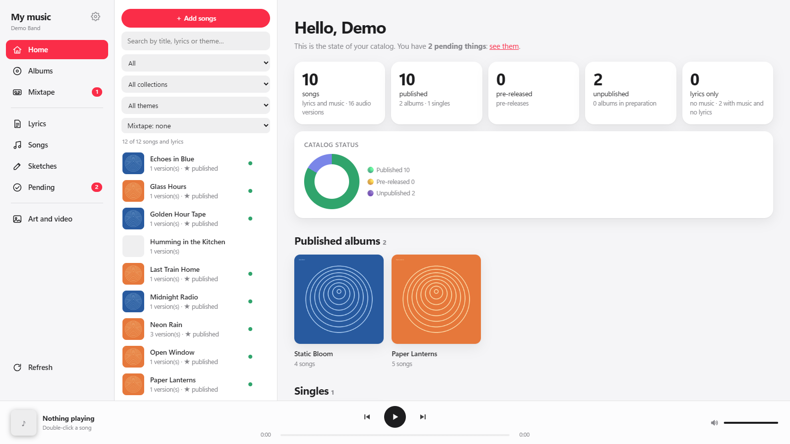

Your catalog at a glance: how many songs you have and how far along each one is (lyrics, version, stems, master, cover, published), plus what is missing. If you import platform reports (CSV), you also get streams by month, platform, country and song. Use it as your starting point: it tells you what to do next.

### Albums
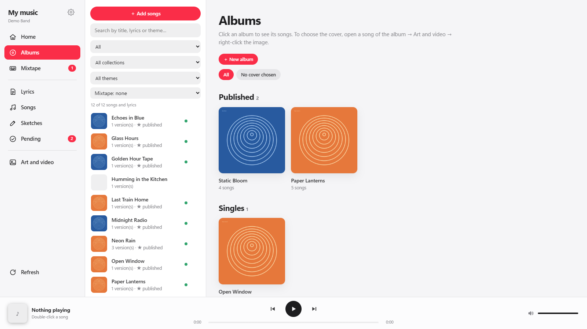

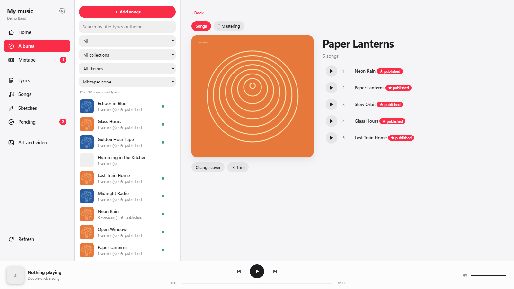

Albums, singles, pre-releases and projects, each with its progress. Create one with **+ New album**, drag songs in from the list, reorder them by dragging, and remove one with the X (the song itself is never deleted or moved). You can change the cover and crop it to 1:1, 4:3, 3:4, 16:9 and 9:16 without touching the original image.

### Songs
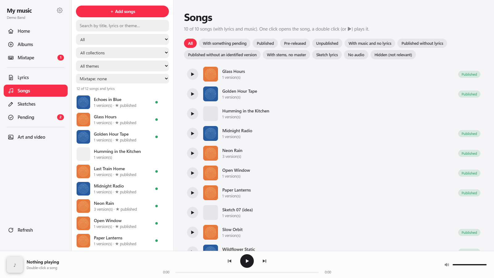

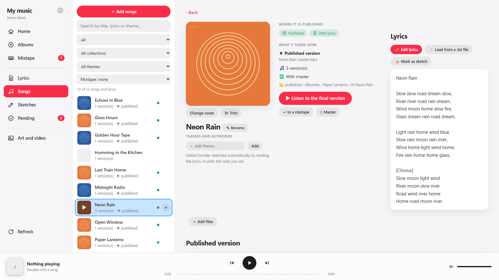

Every song, with search and filters. Open one to play its versions, give it stars and notes, read its lyrics and see its cover. Renaming only changes the name inside the manager, not your folders. To **merge duplicates**, select several songs and right-click → *Merge*. Use ↑/↓ to move between songs and the space bar to play or pause.

### Lyrics
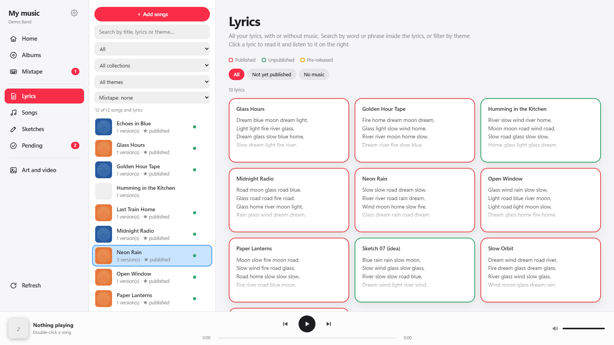

Read and search inside all your lyrics, also by theme. Lyrics are plain text files next to each song, so they stay yours and readable by any other program.

### Sketches
Lyrics that are not meant to be shared: drag them onto **Sketches**. Sketched lyrics are kept out of your mixtapes.

### Pending
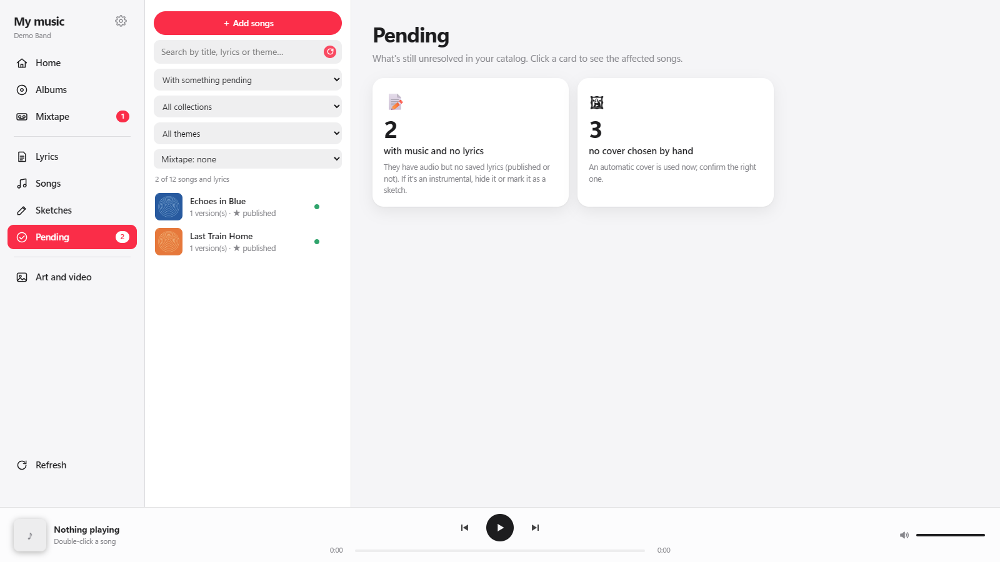

What is still missing per song or album: no lyrics, no master, no cover, and so on. Use it as a to-do list before a release.

### Art & video
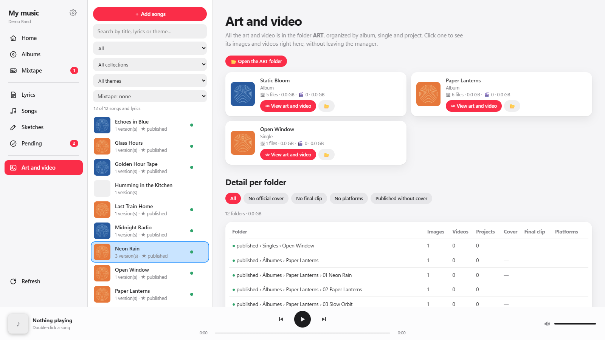

Covers, images and clips of each song or album in one place. Thumbnails are stored in `datos/thumbs`.

### Mixtapes
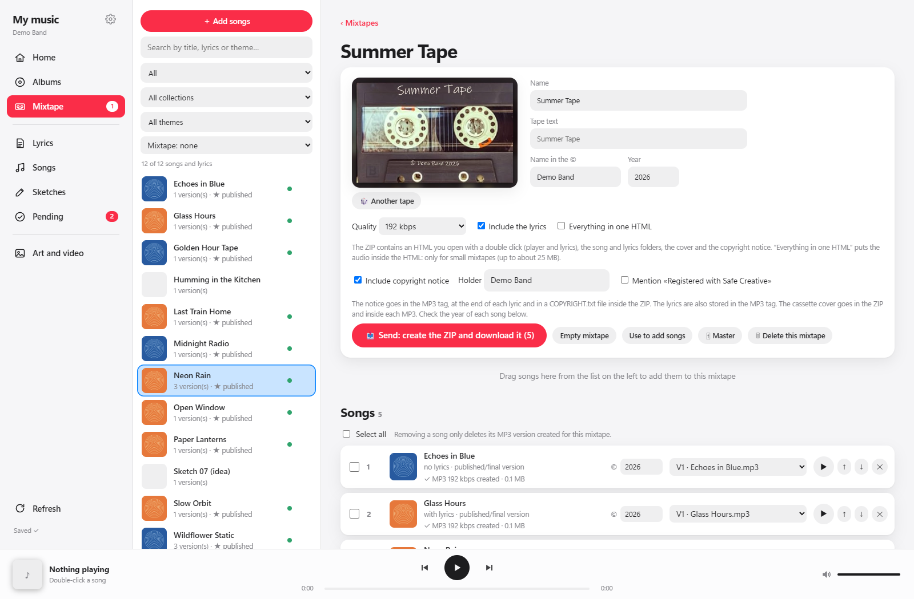

Make as many mixtapes as you want, each with a name, a quality (128, 192 or 320 kbps) and a copyright notice. Drag songs in: the manager creates MP3 versions in `MIXTAPES/_versiones` (your originals are not touched) and a cassette-style cover with your title and © line. **Send** builds a ZIP containing an `Open.html` that your recipient opens with a double click (cover, track list, player and the lyrics of the playing song; no install, no internet), a `Songs` folder with the MP3s, a `Lyrics` folder with one `.txt` per song, `COPYRIGHT.txt` and `Cover.jpg`. File and folder names follow the language you chose in the interface (for example `Abrir.html` in Spanish, `Oeffnen.html` in German). The lyrics are also written inside each MP3's tags. Needs ffmpeg (see the manual).

### Mastering: loudness normalization
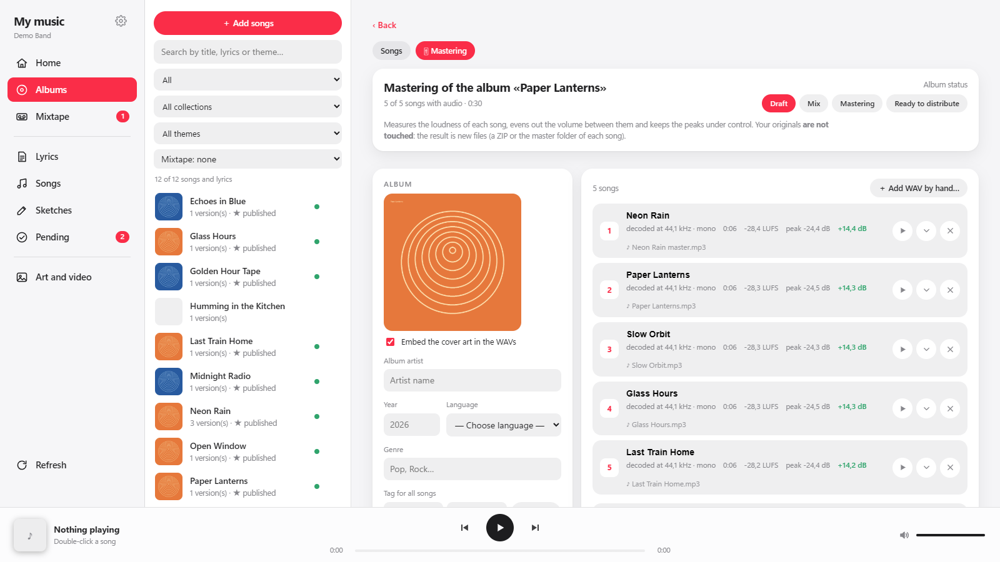

Streaming services and playlists play songs at very different volumes. This tab **measures the loudness (LUFS) of every song** and lets you set a target, so all tracks come out at the same level, with a peak ceiling so nothing clips. Choose *each song at the same volume* (best for singles and playlists) or *respect the differences* (best for albums with deliberately quiet and loud songs). You can listen to the result before saving. Your originals are not modified: the result is exported as a ZIP or saved in the song's `master/` folder (it never overwrites and asks first). Every master is written with your own tags and cover.

It exists in three places: the **Mastering** tab of each album, the **Master** button on each song, and on each mixtape.

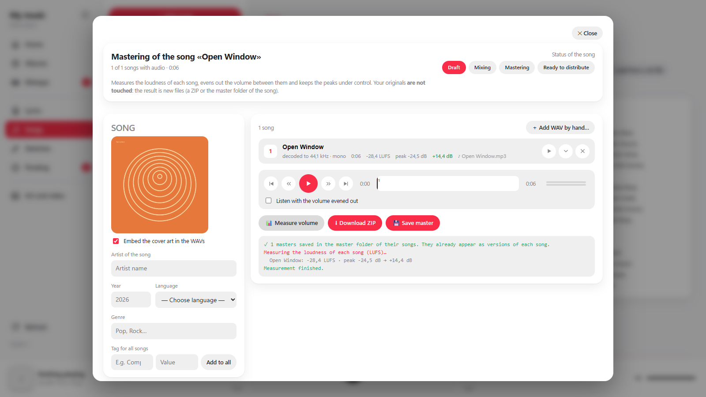

For a single song it works the same way: measure, set the target, listen to the normalized version, save. Your choice to listen with the normalized volume is remembered.

### Metadata
Every file you export (masters, mixtape MP3s) gets *only your* tags: title, artist, album artist, album, track number, year, genre, language, composer, © holder, cover and lyrics. Any tags the original file had are removed, so no stray information travels with your music.

### Import
Open it from **Settings → Import music from other folders**. A four-step wizard (choose folder → search → review → copy) that brings in sketches, versions, stems, live recordings and DAW projects from anywhere. It *copies* into `unreleased/<Title>`, never moves or deletes the source, never overwrites (it adds " (2)"), detects duplicates and groups similar titles. Every copy is logged and can be undone.

### Settings and languages
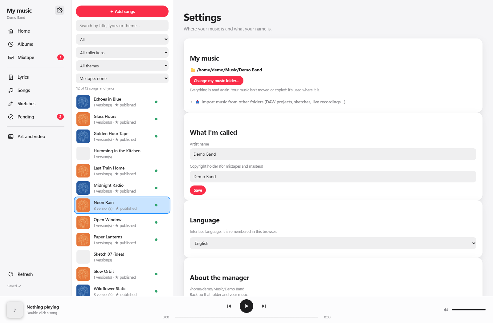

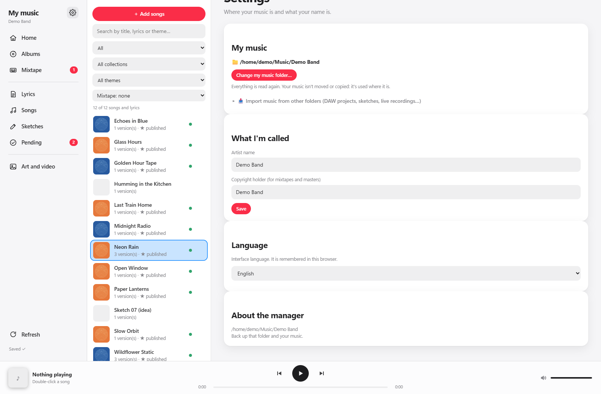

Change your library folder (everything is re-read immediately), your artist name, the copyright holder used on mixtapes, and the interface language: **English, Spanish, German or Portuguese**.

## Build from source

The `paquete/` folder is the complete app (Python standard library only, nothing to install). To run it directly:

```
python paquete/gestor/gestor.py
```

To build the executables yourself: `pip install pyinstaller pillow reportlab`, then `python construir/construir.py --paquete paquete --salida salida`. On GitHub, **Actions → Construir → Run workflow** builds Windows, Mac Intel and Mac Apple Silicon and publishes the zips as a Release. To see how the code is organized, read [ARCHITECTURE.md](ARCHITECTURE.md).

## License

© Frankie De Leonardis. Free to use, including for commercial work with your own output, but you may not sell the program or any part of it. See [LICENSE](LICENSE) and [AVISOS.md](AVISOS.md) (third-party notices).
